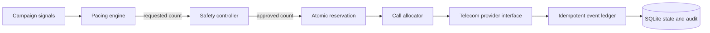

# Architecture Decision: Conservative Agent-Bound Dialing

## Context

Predictive pacing can improve agent utilization by starting calls before an agent is idle, but any connected call must have a human agent ready. A model's answer-rate estimate is not a safety guarantee. Duplicate workers, provider retries, stale state, and out-of-order webhooks must not allocate one agent twice or silently move a terminal call backward.

## Decision

Use a single-process prototype with SQLite as the authority for agent, borrower, and call state. The transaction that reserves the next queued borrower and available agent uses `BEGIN IMMEDIATE`, updates both reservations, creates a call row, and appends an audit record atomically. Workers interact through this reservation operation rather than reading a free agent and claiming it later.

Pacing and call placement have separate interfaces:

The progressive policy proposes one call per available agent. Predictive mode makes an explainable proposal from a clamped answer-rate estimate and target occupancy. The independent safety controller enforces a hard maximum of `min(available agents, queued borrowers)` for every tick and blocks dialing when the provider is unhealthy or the answer-rate signal is below its floor. Each provider attempt therefore already owns a distinct agent before initiation; predictive mode cannot bypass this check.

Provider event IDs are unique. Call lifecycle rules accept forward jumps to tolerate missing/out-of-order intermediate webhooks, ignore duplicate IDs and regressive events, and make terminal states final. Failed or cancelled attempts requeue the borrower. An answered call marks the borrower contacted. Recovery fails stale pre-answer mock calls and frees their reservations; if a worker disappeared after answer, recovery promotes the call to connected and keeps the agent unavailable.

## Consequences

- Connected-call abandonment due to over-dialing is prevented by construction in the simulation.
- Predictive requests may be reduced to the progressive capacity bound. Without a real provider's cancel/hold semantics and a measured answer-latency model, relaxing that cap would turn an estimate into a compliance risk.
- SQLite is suitable for the prototype and makes cross-worker reservation races demonstrable. Its single-writer model will be the first likely bottleneck as agent and event volume grows.
- At larger scale, move the state transaction to PostgreSQL row-level locking (for example `SELECT ... FOR UPDATE SKIP LOCKED`), add an outbox for provider initiation, and preserve the same safety controller and lifecycle invariants. Add distributed locks only if the database transaction no longer owns the reservation truth.
- The mock provider cannot prove telephony cancellation, webhook delivery, or legal compliance. A production adapter must reconcile ambiguous initiation outcomes before releasing a possibly live call's reserved capacity.

## Deferred

No real telecom integration, ML model, Redis/Kafka dependency, campaign UI, or actual load generation is included. The load script measures local SQLite simulation throughput and is not a production capacity claim.